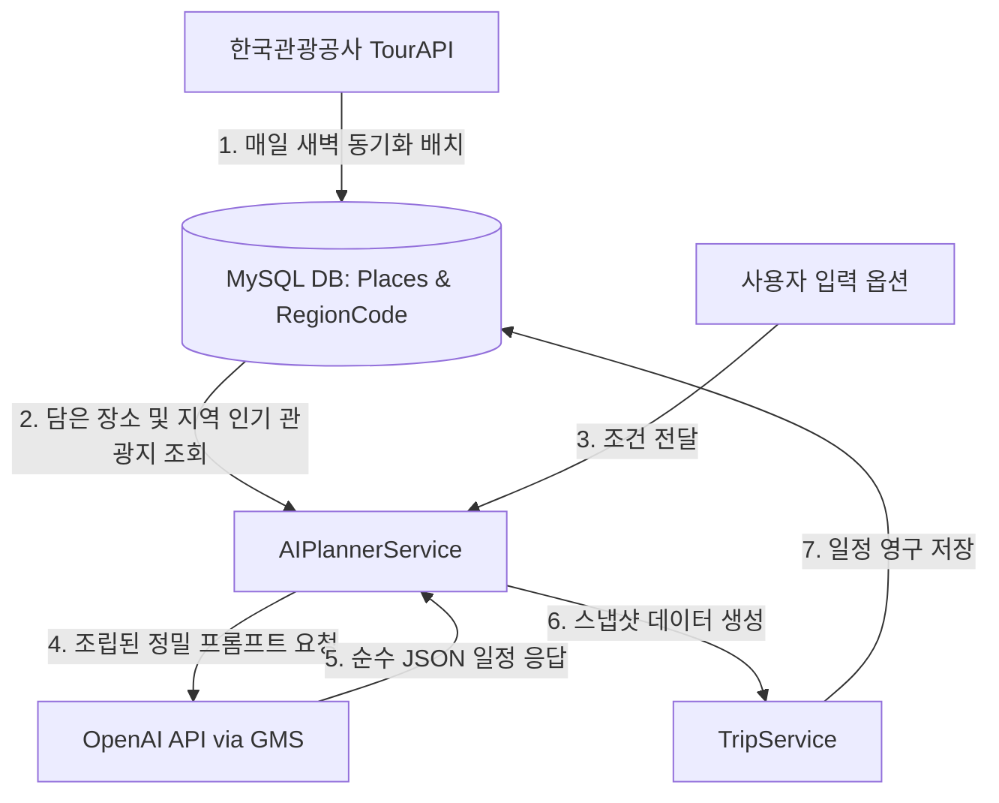
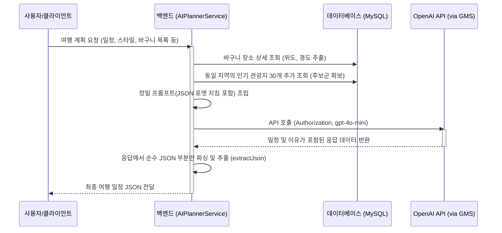

# CourseKok: AI 추천 여행 계획 서비스 기술 명세 및 프로세스 정리

본 문서는 **코스콕 (CourseKok)** 서비스의 목적, 핵심 기능, 그리고 이들을 실현하기 위한 백엔드 아키텍처 및 세부 프로세스를 체계적으로 정리한 문서입니다.

---

## 1. 서비스 목적 (Service Objectives)

코스콕은 사용자가 복잡하게 느끼는 여행 계획 단계를 AI를 통해 획기적으로 단순화하고, 여행의 즐거움을 기록하고 공유할 수 있는 **원스톱 AI 여행 플랫폼**을 지향합니다.

*   **여정 설계의 간소화**: 한국관광공사 공공 데이터를 활용하여 신뢰할 수 있는 여행지를 탐색하고, 사용자가 선택한 장소를 바탕으로 AI가 정교한 맞춤형 코스를 즉시 생성합니다.
*   **사용자 취향 저격**: 여행 기간, 동반 인원, 선호하는 여행 스타일 및 개별 요청사항을 AI에 반영하여 개인화된 최적의 경로를 제공합니다.
*   **경험의 기록과 연결**: 생성된 코스로 다녀온 여행을 **TripLog(여행기)** 형태로 기록하고 공유하여, 다른 사용자들과 영감을 주고받는 여행자 커뮤니티 생태계를 구축합니다.

---

## 2. 핵심 기능 요약 (Core Features)

| 대분류 | 세부 기능 | 설명 |
| :--- | :--- | :--- |
| **데이터 동기화** | TourAPI & 분류코드 동기화 | 한국관광공사의 시도/시군구 법정동 코드 및 분류 카테고리, 전국 관광지 데이터를 매일 자동으로 수집하여 최신 상태로 DB에 동기화합니다. |
| **장소 탐색 & 보관** | 여행지 탐색 & 장소 찜하기 | 전국의 관광지를 검색 및 필터링하고, 마음에 드는 곳을 장소 보관함(바구니)에 담아 AI 계획의 기본 재료로 사용합니다. |
| **AI 코스 생성** | AI 기반 맞춤 코스 추천 | 담아둔 장소들과 여행 옵션(일정, 인원, 스타일, 개별 요구사항 등)을 기반으로 동선을 매끄럽게 연결하고 추가 장소를 추천받아 일자별 일정을 생성합니다. |
| **계획 저장 & 관리** | 여행 일정 영구 저장 | AI가 생성해 준 코스를 사용자의 내 여행 목록에 스냅샷 형태로 저장하고, 상세 일정 및 동선을 언제든지 재조회하거나 관리합니다. |
| **커뮤니티** | TripLog 피드 및 소통 | 여행을 마친 후 후기를 발행하여 공유하고, 다른 사용자들의 여행기에 좋아요, 북마크, 댓글을 통해 소통합니다. |

---

## 3. 백엔드 주요 프로세스 및 아키텍처 (Backend Processes)

백엔드 서버는 **Spring Boot** 환경에서 크게 4개의 핵심 레이어로 동작하며, 외부 API 및 LLM 모델과의 유기적인 연동을 조율합니다.



### [프로세스 1] 외부 데이터 수집 및 자동 동기화 파이프라인
전국의 관광지 정보를 항상 정확하고 풍부하게 유지하기 위해 스케줄러와 동기화 서비스가 배치 방식으로 작동합니다.
*   **관련 클래스**: [TourApiSyncScheduler](file:///c:/SSAFY/workspace/coursekok/backend/CourseKok/src/main/java/com/example/demo/scheduler/TourApiSyncScheduler.java), [TourApiSyncService](file:///c:/SSAFY/workspace/coursekok/backend/CourseKok/src/main/java/com/example/demo/service/TourApiSyncService.java), [ClassificationSyncService](file:///c:/SSAFY/workspace/coursekok/backend/CourseKok/src/main/java/com/example/demo/service/TourApiSyncService.java), [TourApiClient](file:///c:/SSAFY/workspace/coursekok/backend/CourseKok/src/main/java/com/example/demo/service/TourApiClient.java)

#### 1) 구동 시점 자동 초기 적재 (ApplicationReadyEvent)
*   서버 기동 시 DB를 검사하여 `places`와 `classification_codes` 테이블이 비어 있는 경우, 유저 서비스 중단 없이 별도의 비동기 데몬 스레드(`TourApiInitialSyncThread`, `ClassificationInitialSyncThread`)를 생성하여 데이터 수집을 즉시 강제 수행합니다.

#### 2) 새벽 정기 배치 스케줄링
*   매일 새벽 3시(`@Scheduled(cron = "0 0 3 * * *")`)에 전체 데이터 동기화 배치가 수행됩니다.

#### 3) 세부 연동 흐름
1.  **Fallback 오염 데이터 제거**: 기존 테스트나 예외 상황으로 수집된 잘못된 분류 코드(예: 지역코드 "99" 등)를 먼저 물리 삭제하여 데이터 무결성을 확보합니다.
2.  **행정구역 정보 수집**: TourAPI 법정동 코드 API를 호출하여 시도 목록을 가져온 후, 각 시도별 시군구 코드를 탐색해 `RegionCode` 엔티티로 적재합니다. (인메모리 캐싱을 통해 DB 조회를 최소화)
3.  **지역별 관광지 목록 조회**: 구축된 각 시군구 지역 코드를 기반으로 대량의 지역기반 관광정보(`areaBasedList2`)를 1,000건 단위 페이징으로 호출합니다.
4.  **Upsert 배치 및 벌크 저장**: 기존 DB의 장소 데이터 전체를 메모리에 올려 캐싱한 뒤, API 결과와 대조하여 신규 장소는 신규 적재(최초 조회수 및 평점은 랜덤 부여), 기존 장소는 필드를 갱신합니다. OOM 방지 및 성능 효율을 위해 **2,000건 단위로 분할하여 벌크 저장(`saveAll`)**합니다.
5.  **누락 데이터 비활성화 (Soft Delete)**: 수집 도중 제외되었거나 유실된 이전 데이터들은 실시간으로 물리 삭제하지 않고, 배치 시작 시간 기준 수정이 일어나지 않은 대상만 골라 `isDeleted = true`로 처리하는 **Soft Delete**를 적용합니다.

---

### [프로세스 2] 사용자 장소 보관함(바구니) 관리
사용자가 탐색 중에 마음에 드는 곳을 골라 보관할 수 있도록 찜하기 기능이 제공되며, AI 일정 설계의 핵심 소스로 기능합니다.
*   **관련 클래스**: [SavedPlaceController](file:///c:/SSAFY/workspace/coursekok/backend/CourseKok/src/main/java/com/example/demo/controller/SavedPlaceController.java), [SavedPlaceService](file:///c:/SSAFY/workspace/coursekok/backend/CourseKok/src/main/java/com/example/demo/service/SavedPlaceService.java)

1.  **장소 찜하기**: 로그인 사용자 식별을 거쳐 특정 `placeId`를 담을 때 중복 저장을 차단하기 위한 예외 처리(`DuplicateSavedPlaceException`)를 수행한 후 `SavedPlace` 엔티티를 영구 저장합니다.
2.  **보관함 목록 조회**: 페이징 처리 및 가독성을 위한 DTO 매핑(`PlaceSummaryResponse`)을 적용해 유저에게 전달합니다.

---

### [프로세스 3] AI 기반 여행 코스 추천
사용자가 요청한 여행 제약조건과 보관함 내부의 장소 정보를 활용하여 정교한 동선을 수집하고 AI 모델을 통해 지능화된 코스를 생성합니다.
*   **관련 클래스**: [AIPlannerController](file:///c:/SSAFY/workspace/coursekok/backend/CourseKok/src/main/java/com/example/demo/controller/AIPlannerController.java), [AIPlannerService](file:///c:/SSAFY/workspace/coursekok/backend/CourseKok/src/main/java/com/example/demo/service/AIPlannerService.java)



#### 세부 동작 과정
1.  **바구니 장소 상세 조회**: 사용자가 보낸 장소 ID 배열(`savedPlaceIds`)을 통해 DB에서 장소의 정식 명칭, 주소, 위도(`mapY`), 경도(`mapX`) 정보를 매핑합니다.
2.  **동선 보완용 주변 인기 관광지 후보 수집**: 유저가 보관함에 담은 첫 번째 장소의 법정동 시도 코드를 추출하고, 동일한 지역 내의 평점/조회수가 높은 **인기 관광지 상위 30개**를 동적으로 가져옵니다. (바구니에 이미 담긴 장소는 제외)
3.  **정밀 시스템 프롬프트 조립**:
     *   **조건 주입**: 여행 시작일, 종료일, 여행 인원, 스타일 키워드 리스트, 기타 요청사항.
     *   **장소 주입**: 필수 배치할 '바구니 장소' 리스트 + 동선 연결 및 보완용 '인기 후보 장소' 리스트(각각 위경도 좌표 포함).
     *   **제약 조건**: LLM이 허구의 장소나 위경도 좌표를 임의 생성하는 할루시네이션(Hallucination) 현상을 원천 방지하기 위해 **"제공된 장소 이름과 위경도 좌표를 100% 일치시켜 사용할 것"**을 강력히 지시합니다.
     *   **포맷 규격화**: 프론트엔드 연동 신뢰도를 위해 별도의 대화형 텍스트를 제거하고 완벽한 JSON 포맷 스키마 규격으로만 리턴하도록 프롬프트 레벨에서 제어합니다.
4.  **OpenAI API 연동**:
    *   통합 게이트웨이 서비스(GMS)를 경유하여 OpenAI API (`gpt-4o-mini`)를 호출합니다.
    *   `RestTemplate`과 적절한 헤더 정보(`Authorization: Bearer <Key>`)를 설정하여 요청을 전송합니다.
5.  **JSON 데이터 추출 및 반환**: LLM 응답에 섞일 수 있는 마크다운 코드 블록 지시어(예: ` ```json ` 등)를 유틸리티 메서드(`extractJson`)를 사용해 제거하여, 프론트엔드가 즉각 파싱할 수 있는 순수 JSON 배열 문자열 형태로 정제하여 클라이언트에 내려줍니다.

---

### [프로세스 4] 여행 일정 영구 저장 및 관리
AI 플래너를 통해 확정된 시나리오 코스를 유저의 영구적인 자산으로 보관합니다.
*   **관련 클래스**: [TripController](file:///c:/SSAFY/workspace/coursekok/backend/CourseKok/src/main/java/com/example/demo/controller/TripController.java), [TripService](file:///c:/SSAFY/workspace/coursekok/backend/CourseKok/src/main/java/com/example/demo/service/TripService.java)

1.  **Security Context 활용**: SecurityContextHolder로부터 인증된 사용자의 이메일을 가져와 고유 식별자로 매핑합니다.
2.  **스냅샷 저장**: AI가 추천한 세부 계획의 원본 데이터를 훼손하지 않기 위해 JSON 포맷을 그대로 문자열 스냅샷(`aiPlanSnapshot`) 데이터로 정의하여 `Trip` 엔티티와 함께 MySQL DB에 영구 적재합니다.
3.  **목록 및 상세 조회**: 내 여행 리스트를 최신순으로 반환하거나, 특정 `tripId`에 바인딩된 스냅샷 일정을 조회하여 지도 및 동선 렌더링에 사용합니다.

---

### [프로세스 5] 여행 기록(TripLog) 공유 및 커뮤니티 피드
자신이 직접 설계하고 경험한 일정을 타인에게 공유하고 피드백을 주고받는 최종적인 가치 창출 프로세스입니다.
*   **관련 클래스**: [TripLogController](file:///c:/SSAFY/workspace/coursekok/backend/CourseKok/src/main/java/com/example/demo/controller/TripLogController.java), [TripLogService](file:///c:/SSAFY/workspace/coursekok/backend/CourseKok/src/main/java/com/example/demo/service/TripLogService.java)

1.  **공개 피드 제공**: 정렬 필터(최신순 `recent`, 인기순 `popular`, 포토 우선 `photo`, 경로 위주 `route`)에 따라 효율적으로 나누어 목록 페이징 조회를 제공합니다.
2.  **발행 및 수정**: 사용자는 특정 여행(`Trip`)을 기반으로 본인만의 여행 후기(TripLog)를 작성하여 게시판에 발행할 수 있습니다.
3.  **반응(좋아요/북마크) 및 댓글**: 사용자는 마음에 드는 타인의 여행기에 대해 좋아요와 북마크를 토글 처리하고, 실시간 소통을 위해 댓글 목록을 조회 및 추가/삭제할 수 있는 하위 도메인 프로세스를 가집니다.
