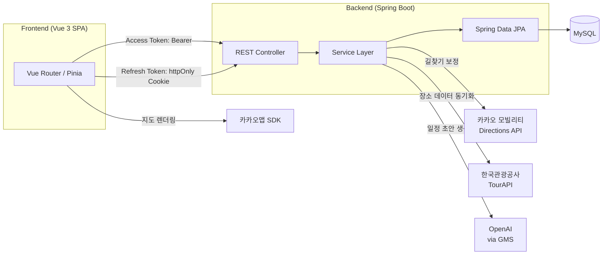

<div align="center">
  

# CourseKok (코스콕)

지도 기반으로 여행지를 탐색하고, AI 추천으로 일정을 짜고, 여행 기록을 남기는 여행 플래닝 서비스

</div>

## 프로젝트 소개

코스콕은 "여행지를 지도 위에서 콕콕 찍어본다"는 컨셉의 여행 플래닝 서비스입니다. 카카오맵으로 지역·카테고리별 장소를 탐색하고, 마음에 드는 곳을 담아 AI에게 일정 초안을 맡긴 뒤, 다녀온 여행은 기록(TripLog)으로 남겨 다른 사용자와 공유할 수 있습니다.

## 핵심 기능

| 기능            | 설명                                                                                                                                 |
| --------------- | ------------------------------------------------------------------------------------------------------------------------------------ |
| 장소 탐색       | 카카오맵 위에서 지역/시군구, 카테고리(관광지·맛집·숙박·축제)로 장소를 검색·필터링. 지도 이동 시 현재 화면 범위 내 장소도 실시간 조회 |
| AI 일정 추천    | 담아둔 장소를 바탕으로 OpenAI(GMS 경유)가 일자별 일정 초안을 생성하고, 카카오 모빌리티 Directions API로 이동 시간을 보정             |
| 내 여행 관리    | 여행(Trip) 생성·수정·삭제, 일자별 방문 장소(TripPlace) 구성                                                                          |
| 여행기(TripLog) | 여행 후기 작성 및 공개 범위 설정, 좋아요·댓글·북마크                                                                                 |
| 라운지          | 장소(스팟) 등록과 리뷰 작성                                                                                                          |
| 찜한 장소       | 관심 장소 저장/해제                                                                                                                  |
| 인증            | 회원가입·로그인, Access Token + Refresh Token(JWT) 기반 인증, Refresh Token은 httpOnly Cookie로 관리                                 |

## 시스템 구조



백엔드는 Controller → Service → Repository(JPA)의 계층 구조를 따르며, 인증은 Access Token(응답 바디, Pinia 메모리 저장) + Refresh Token(httpOnly Cookie) 조합으로 처리합니다.

## 개발 환경

| 구분                | 버전/도구                                                                            |
| ------------------- | ------------------------------------------------------------------------------------ |
| Frontend 런타임     | Node.js `^20.19.0` 또는 `>=22.12.0`, pnpm                                            |
| Frontend 프레임워크 | Vue 3.5 (Composition API), Vue Router, Pinia, Vite 8, Axios                          |
| Backend 런타임      | JDK 21                                                                               |
| Backend 프레임워크  | Spring Boot 4.0.6, Spring Security, Spring Data JPA                                  |
| 인증                | JJWT (JWT 발급/검증)                                                                 |
| DB                  | MySQL (mysql-connector-j)                                                            |
| API 문서화          | SpringDoc OpenAPI (Swagger)                                                          |
| 외부 API            | 카카오맵 SDK, 카카오 모빌리티 Directions API, 한국관광공사 TourAPI, OpenAI(GMS 경유) |

## 프로젝트 구조

```
coursekok/
├── frontend/         # Vue 3 SPA
├── backend/CourseKok/ # Spring Boot API 서버
├── Database/         # DDL, 마이그레이션, DB 스펙 문서
└── docs/             # 기술 문서 (docs/archive는 과거 작업 기록)
```

## 시작하기

### 사전 요구 사항

- Node.js `^20.19.0` 또는 `>=22.12.0`, pnpm
- JDK 21
- MySQL

### 1. 데이터베이스 준비

MySQL에 데이터베이스를 생성한 뒤 `Database/CourseKok DDL.sql`(필요 시 `migration_v2.sql`)을 실행합니다.

### 2. 백엔드 실행

`backend/CourseKok/src/main/resources/application-secret.properties` 파일을 새로 만들고 아래 값을 채워주세요 (이 파일은 git에 커밋되지 않습니다).

```properties
DB_URL=jdbc:mysql://localhost:3306/{본인 DB명}?serverTimezone=UTC&characterEncoding=UTF-8
DB_USERNAME=your_db_username
DB_PASSWORD=your_db_password

jwt.secret=your-very-long-secure-secret-key-at-least-32-chars

tourapi.service-key=your_tour_api_service_key

GMS_KEY=your_gms_api_key
KAKAO_REST_API_KEY=your_kakao_rest_api_key
```

```bash
cd backend/CourseKok
./mvnw spring-boot:run
```

기본적으로 `http://localhost:8080`에서 실행됩니다.

### 3. 프론트엔드 실행

`frontend/.env.example`을 복사해 `frontend/.env`를 만들고 값을 채워주세요.

```
VITE_API_BASE_URL=http://localhost:8080/api
VITE_KAKAO_MAP_KEY=your_kakao_map_key
VITE_KAKAO_REST_API_KEY=your_kakao_rest_api_key
```

```bash
cd frontend
pnpm install
pnpm dev
```

기본적으로 `http://localhost:5173`에서 실행됩니다.

## 문서

- [`docs/AI_PLANNER_SERVICE.md`](docs/AI_PLANNER_SERVICE.md) — AI 플래너 기술 명세
- [`docs/KAKAOMOBILITY_DIRECTIONS_API.md`](docs/KAKAOMOBILITY_DIRECTIONS_API.md) — 카카오 모빌리티 길찾기 API 가이드
- [`Database/database-specification.md`](Database/database-specification.md) — DB 스펙
- [`docs/archive/`](docs/archive/) — 개발 과정에서 작성된 기획/점검 문서 (참고용, 최신 상태 아닐 수 있음)
