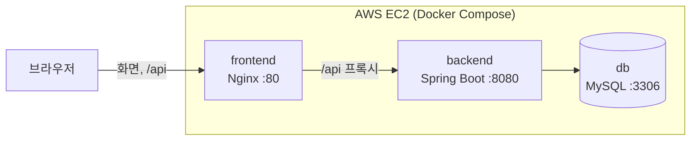
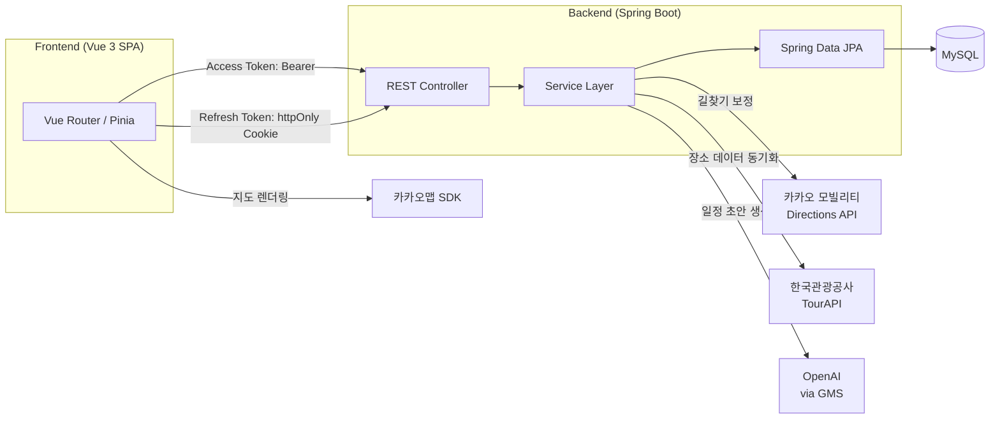

<div align="center">
  

# CourseKok v2 (코스콕)

지도에서 여행지를 고르고, AI로 일정을 짜고, 여행 기록을 남기는 여행 플래닝 서비스

</div>

## 이 저장소는

- SSAFY 1학기 관통 프로젝트로 만든 2인 팀 프로젝트 **코스콕**을 이어받아, 혼자 배포와 인프라, 프론트 개선까지 직접 해보는 저장소
- 원본: Vue 3 + Spring Boot + MySQL, 로컬에서만 실행되던 상태
- v2 목표: Docker 컨테이너화 → 서버 배포 → CI/CD 자동화 → React 전환
- 과정과 트러블슈팅은 [개발 기록(devlog)](docs/devlog/README.md)에 날짜별로 정리

### v1 / v2

| | v1 (원본 팀 프로젝트) | v2 (이 저장소) |
|---|---|---|
| 기간 | ~ 2026.06 | 2026.10 ~ |
| 인원 | 2인 | 1인 |
| 내 역할 | UI/UX 설계 전담, JWT 인증/인가, TripLog, MyPage, 장소 검색 UI | 전체 |
| 실행 환경 | 로컬 (MySQL 직접 설치) | Docker Compose, AWS EC2 |
| 비고 | SSAFY 1학기 관통 프로젝트 우수상 (서울 8반 2등) | |

v1 시점의 코드는 [`v1-vue`](../../tree/v1-vue) 태그로 보존

## 진행 상황

| 단계 | 내용 | 상태 |
|---|---|---|
| 0 | Docker로 로컬 MySQL, 백엔드 연결 | 완료 |
| 1 | 백엔드 Dockerfile | 완료 |
| 2 | Docker Compose (백엔드 + DB) | 완료 |
| 3 | 프론트 Nginx 컨테이너, 전체 Compose | 완료 |
| 4 | AWS EC2 배포 | 완료 |
| 5 | GitHub Actions 자동 배포 | 예정 |
| 6 | React 전환, 반응형, 성능 개선 | 예정 |

## 배포 구조



- 브라우저는 Nginx(80)하고만 통신, `/api` 요청은 Nginx가 백엔드로 전달 → 같은 출처라 CORS 설정 불필요
- 외부에 여는 포트는 80(HTTP), 22(SSH)뿐. DB와 백엔드 포트는 보안 그룹에서 차단
- 컨테이너끼리는 서비스 이름(`db`, `backend`)으로 통신

## 실행 방법

### 사전 준비

- Docker Desktop
- (로컬 개발 시) JDK 21, Node.js `^20.19.0` 또는 `>=22.12.0`, pnpm
- API 키: 아래 [API 키 발급](#api-키-발급) 참고

### 환경변수 파일

| 파일 | 읽는 쪽 | 쓰는 상황 | 예시 파일 |
|---|---|---|---|
| `.env` (루트) | Docker Compose | 전체를 Docker로 실행할 때 | `.env.example` |
| `application-secret.properties` | Spring | IntelliJ로 백엔드를 실행할 때 | `backend/CourseKok/src/main/resources/application-secret.properties.example` |
| `frontend/.env` | Vite (빌드 시점) | 프론트 개발, 빌드할 때 | `frontend/.env.example` |

세 파일 모두 `.gitignore` 대상. 예시 파일을 복사해서 값을 채우면 됨

### A. 로컬 개발 (코드 고치면서 확인할 때)

DB만 Docker로 띄우고, 백엔드와 프론트는 직접 실행

```bash
# 1. DB 실행 (처음 켜질 때 Database/의 SQL로 테이블 자동 생성)
docker compose up -d db

# 2. 백엔드: IntelliJ에서 CourseKokApplication 실행
#    (application-secret.properties 의 DB_URL은 localhost:3307)

# 3. 프론트
cd frontend
pnpm install
pnpm dev
```

- 프론트: `http://localhost:5173`
- 백엔드 API 문서: `http://localhost:8080/swagger-ui/index.html`

### B. 전체 실행 (서버와 같은 구성으로 확인할 때)

```bash
# 1. 백엔드 jar 빌드
cd backend/CourseKok
./mvnw clean package -DskipTests

# 2. 프론트 빌드 (frontend/.env 의 VITE_API_BASE_URL=/api)
cd ../../frontend
pnpm install
pnpm build

# 3. 전체 실행
cd ..
docker compose up -d --build
```

- 접속: `http://localhost`
- 종료: `docker compose down` (DB 데이터 유지)
- DB까지 초기화: `docker compose down -v`

## API 키 발급

| 키 | 쓰는 곳 | 발급처 |
|---|---|---|
| 카카오 JavaScript 키 | `VITE_KAKAO_MAP_KEY` (지도) | 카카오 개발자 콘솔 |
| 카카오 REST API 키 | `KAKAO_REST_API_KEY` (길찾기) | 카카오 개발자 콘솔 |
| TourAPI 서비스 키 | `TOURAPI_SERVICE_KEY`, `tourapi.service-key` (장소 데이터) | 공공데이터포털 |
| GMS 키 | `GMS_KEY` (AI 일정 생성) | SSAFY GMS |
| JWT 시크릿 | `JWT_SECRET` | 직접 생성 |
| DB 비밀번호 | `DB_PASSWORD` | 직접 정하기 |

### 카카오 (지도, 길찾기)

1. [Kakao Developers](https://developers.kakao.com) 로그인 → **내 애플리케이션 → 애플리케이션 추가하기**
2. **앱 키**에서 JavaScript 키(프론트), REST API 키(백엔드) 확인
3. **플랫폼 → Web → 사이트 도메인**에 접속할 주소 등록
   - `http://localhost:5173`, `http://localhost`, 서버 주소
   - 등록 안 된 주소에서는 지도가 뜨지 않음
4. 카카오맵 사용 설정이 꺼져 있으면 앱 설정에서 활성화

### 한국관광공사 TourAPI (장소 데이터)

1. [공공데이터포털](https://www.data.go.kr) 로그인
2. "한국관광공사 국문 관광정보 서비스" 검색 → **활용신청**
3. 승인 후 마이페이지에서 **일반 인증키(Decoding)** 복사

### SSAFY GMS (AI 일정 생성)

- SSAFY 교육생에게 제공되는 OpenAI 프록시 키
- 없으면 AI 일정 생성 기능만 동작하지 않고 나머지 기능은 정상

### JWT 시크릿 생성 (PowerShell)

```powershell
$b = New-Object byte[] 48
[System.Security.Cryptography.RandomNumberGenerator]::Create().GetBytes($b)
[Convert]::ToBase64String($b)
```

- HS256 서명용이라 32바이트 이상 필요
- 유출되면 토큰 위조 가능, 바꾸면 기존 로그인 전부 만료

## 주요 트러블슈팅

| 문제 | 원인 | 기록 |
|---|---|---|
| 빌드 후 아이콘 모듈 로드 실패 (MIME text/html) | `@vite-ignore` 동적 import로 아이콘이 빌드에서 빠짐. 개발 서버에선 안 보이던 문제 | [기록](docs/devlog/2026-10-14-frontend-docker.md) |
| 컨테이너에서 DB 접속 실패 | 컨테이너 안의 `localhost`는 컨테이너 자신. Compose 서비스 이름으로 해결 | [기록](docs/devlog/2026-10-14-docker-compose.md) |
| 비밀 설정 파일이 jar에 포함 | Maven은 `.gitignore`와 무관하게 resources를 전부 패키징. optional import + 실행 시 환경변수 주입으로 분리 | [기록](docs/devlog/2026-10-13-backend-dockerfile.md) |

## 서비스 소개

### 핵심 기능

| 기능 | 설명 |
|---|---|
| 장소 탐색 | 카카오맵 위에서 지역, 카테고리(관광지, 맛집, 숙박, 축제)별 장소 검색. 지도 이동 시 화면 범위 내 장소 실시간 조회 |
| AI 일정 추천 | 담아둔 장소로 OpenAI(GMS)가 일자별 일정 초안 생성, 카카오 모빌리티 길찾기로 이동 시간 보정 |
| 내 여행 관리 | 여행 생성, 수정, 삭제, 일자별 방문 장소 구성 |
| 여행기 (TripLog) | 여행 후기 작성, 공개 범위 설정, 좋아요, 댓글, 북마크 |
| 라운지 | 장소 등록과 리뷰 |
| 찜한 장소 | 관심 장소 저장 |
| 인증 | Access Token + Refresh Token(JWT). Refresh Token은 httpOnly Cookie |

### 시스템 구조



### 기술 스택

| 구분 | 사용 기술 |
|---|---|
| Frontend | Vue 3.5 (Composition API), Vue Router, Pinia, Vite 8, Axios |
| Backend | Spring Boot 4.0.6, Spring Security, Spring Data JPA, JJWT, SpringDoc(Swagger) |
| DB | MySQL 8.4 |
| Infra | Docker, Docker Compose, Nginx, AWS EC2 |
| 외부 API | 카카오맵 SDK, 카카오 모빌리티 Directions API, 한국관광공사 TourAPI, OpenAI(GMS) |

## 프로젝트 구조

```
coursekok-v2/
├── frontend/              # Vue 3 SPA, Dockerfile, nginx.conf
├── backend/CourseKok/     # Spring Boot API, Dockerfile
├── Database/              # DDL, 마이그레이션 SQL (DB 컨테이너 첫 실행 시 자동 적용)
├── docs/
│   ├── devlog/            # v2 개발 기록
│   └── archive/           # v1 기획, 점검 문서
├── docker-compose.yml
└── .env.example
```

## 문서

- [개발 기록 (devlog)](docs/devlog/README.md)
- [AI 플래너 기술 명세](docs/AI_PLANNER_SERVICE.md)
- [카카오 모빌리티 길찾기 API 가이드](docs/KAKAOMOBILITY_DIRECTIONS_API.md)
- [DB 스펙](Database/database-specification.md)
